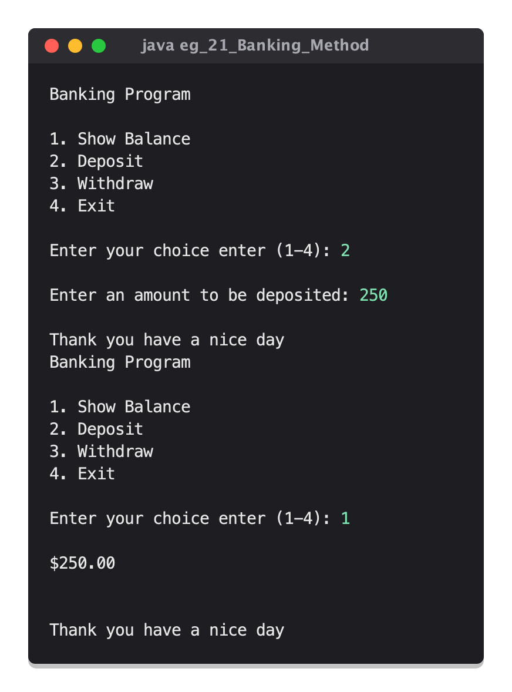
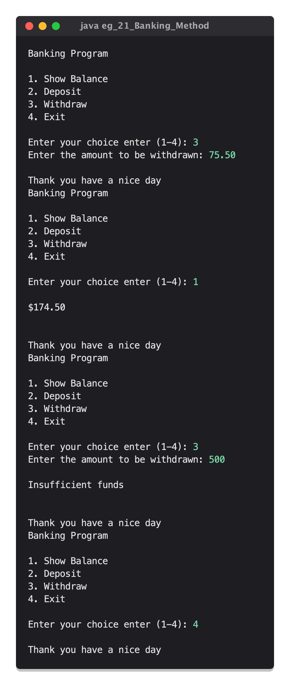

# Banking-Method
This Java project models a basic bank account system. Users can deposit and withdraw funds while the program tracks the account balance. It demonstrates object-oriented programming concepts such as classes, methods, and encapsulation.

## Screenshots

| Deposit and check balance | Withdraw, with an overdraft blocked |
|---|---|
|  |  |

## How it works
- A menu loop (show balance, deposit, withdraw, exit) runs until the user chooses Exit.
- Deposits and withdrawals are checked: negative amounts are rejected, and a withdrawal larger than the balance shows "Insufficient funds".

## Run it
Requires Java 17+.
```
javac eg_21_Banking_Method.java
java eg_21_Banking_Method
```
